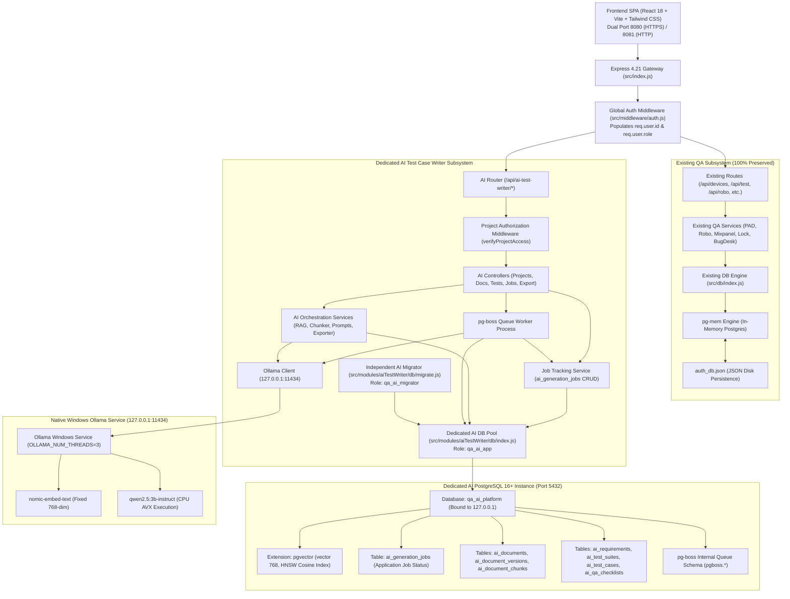
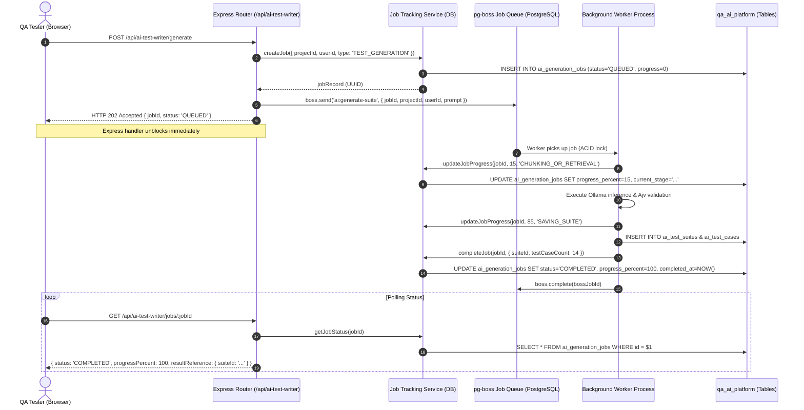

# Phase 1.2: Final Architecture Corrections Before Implementation
## AI Test Case Writer Subsystem

**Document Version:** 1.2.0  
**Date:** October 30, 2026  
**Status:** Approved Final Architecture Blueprint (Strictly Read-Only — No Code Modified)  
**Target Platform:** Windows 10 Pro (x64) • Native PostgreSQL 16 + pgvector • pg-boss • Ollama (CPU)

---

## 1. Executive Summary & Final Corrections

This document establishes the final, approved architectural blueprint for the **AI Test Case Writer** module within the Centralized QA Tools Platform. It directly addresses the final requirements defined in Phase 1.2:

1. **Application-Level Generation Job Tracking**: Defined a dedicated, persistent `ai_generation_jobs` table. It maintains queryable progress percentages, processing stages, error diagnostics, and result links, working in tandem with the low-level `pg-boss` queue runner.
2. **Authoritative Document Version Activation**: Established `ai_documents.active_version_id` as the single authoritative source of truth. Document versions are chunked, embedded, and verified *before* activation. Activation occurs inside an atomic database transaction with rollback guarantees and zero RAG context contamination.
3. **Fixed Embedding Configuration**: Standardized strictly on `nomic-embed-text` fixed at 768 dimensions for the initial release. Managed via a dedicated `ai_embedding_config` table that strictly enforces model consistency between chunk vectors and query vectors.
4. **End-to-End Project Authorization**: Built an external identity link with the existing authentication system (`req.user.id`). Enforced project ownership and membership verification on every document, generation, and retrieval route, with hard multi-tenant SQL filtering.
5. **Least-Privilege Database Security**: Removed default superuser credentials. Defined segregated application (`qa_ai_app`) and migration (`qa_ai_migrator`) database roles with local-only host binding (`127.0.0.1`).
6. **Empirical Benchmarking Standards**: Replaced arbitrary performance guarantees with realistic benchmark criteria tailored to the host's 4-core Intel Core i5-3470S CPU and 7.15 GB available RAM.
7. **Native Windows Installation Strategy**: Audited the Windows 10 Pro host (Build 19044) and confirmed Docker is not installed. Outlined a native Windows installation strategy (Native EDB PostgreSQL 16 + compiled `pgvector` binaries + native Windows Ollama service) to avoid the 3–4 GB memory overhead of Docker/WSL2.

---

## 2. Final Architecture Diagram



---

## 3. Dedicated Database Schema (Corrected DDL)

All tables reside strictly inside the dedicated `qa_ai_platform` database.

```sql
-- ============================================================================
-- AI TEST CASE WRITER DDL (qa_ai_platform)
-- ============================================================================

CREATE EXTENSION IF NOT EXISTS "uuid-ossp";
CREATE EXTENSION IF NOT EXISTS "vector";

-- 1. Schema Migration History
CREATE TABLE IF NOT EXISTS ai_schema_migrations (
    id SERIAL PRIMARY KEY,
    name VARCHAR(255) UNIQUE NOT NULL,
    applied_at TIMESTAMPTZ DEFAULT NOW()
);

-- 2. Embedding Configuration (Strict Single Model Enforced)
CREATE TABLE IF NOT EXISTS ai_embedding_config (
    id UUID PRIMARY KEY DEFAULT gen_random_uuid(),
    model_name VARCHAR(100) NOT NULL DEFAULT 'nomic-embed-text',
    model_version VARCHAR(50) NOT NULL DEFAULT 'v1.5',
    dimensions INT NOT NULL DEFAULT 768,
    distance_metric VARCHAR(50) NOT NULL DEFAULT 'cosine',
    is_active BOOLEAN NOT NULL DEFAULT TRUE,
    created_at TIMESTAMPTZ NOT NULL DEFAULT NOW(),
    CONSTRAINT uq_active_embedding_model UNIQUE (is_active)
);

-- Seed default embedding config
INSERT INTO ai_embedding_config (model_name, model_version, dimensions, distance_metric, is_active)
VALUES ('nomic-embed-text', 'v1.5', 768, 'cosine', TRUE)
ON CONFLICT (is_active) DO NOTHING;

-- 3. Projects
CREATE TABLE IF NOT EXISTS ai_projects (
    id UUID PRIMARY KEY DEFAULT gen_random_uuid(),
    name VARCHAR(255) NOT NULL,
    slug VARCHAR(255) UNIQUE NOT NULL,
    description TEXT,
    app_package_name VARCHAR(255),
    pms_project_id VARCHAR(100),
    mixpanel_project_id VARCHAR(100),
    created_by_user_id UUID NOT NULL,       -- External reference to existing User UUID
    status VARCHAR(50) NOT NULL DEFAULT 'ACTIVE',
    settings JSONB NOT NULL DEFAULT '{
        "default_priority": "MEDIUM",
        "require_human_review": true,
        "inference_model": "qwen2.5:3b-instruct"
    }',
    created_at TIMESTAMPTZ NOT NULL DEFAULT NOW(),
    updated_at TIMESTAMPTZ NOT NULL DEFAULT NOW()
);
CREATE INDEX IF NOT EXISTS idx_ai_proj_creator ON ai_projects(created_by_user_id);
CREATE INDEX IF NOT EXISTS idx_ai_proj_status ON ai_projects(status);

-- 4. Documents (Permanent Entity)
CREATE TABLE IF NOT EXISTS ai_documents (
    id UUID PRIMARY KEY DEFAULT gen_random_uuid(),
    project_id UUID NOT NULL REFERENCES ai_projects(id) ON DELETE CASCADE,
    title VARCHAR(255) NOT NULL,
    original_filename VARCHAR(255) NOT NULL,
    document_type VARCHAR(50) NOT NULL,     -- 'PDF', 'DOCX', 'XLSX', 'CSV', 'TXT'
    active_version_id UUID,                 -- Authoritative active version pointer
    created_by_user_id UUID NOT NULL,
    created_at TIMESTAMPTZ NOT NULL DEFAULT NOW(),
    updated_at TIMESTAMPTZ NOT NULL DEFAULT NOW()
);
CREATE INDEX IF NOT EXISTS idx_ai_docs_project ON ai_documents(project_id);

-- 5. Document Versions (Permanent Immutable Revisions)
CREATE TABLE IF NOT EXISTS ai_document_versions (
    id UUID PRIMARY KEY DEFAULT gen_random_uuid(),
    document_id UUID NOT NULL REFERENCES ai_documents(id) ON DELETE CASCADE,
    version_number INT NOT NULL,
    sha256_hash VARCHAR(64) NOT NULL,
    file_size_bytes BIGINT NOT NULL,
    storage_path VARCHAR(512) NOT NULL,
    indexing_status VARCHAR(50) NOT NULL DEFAULT 'PENDING',
    -- 'PENDING', 'CHUNKING', 'EMBEDDING', 'COMPLETED', 'FAILED'
    indexing_error TEXT,
    total_chunks INT NOT NULL DEFAULT 0,
    change_summary TEXT,
    uploaded_by_user_id UUID NOT NULL,
    created_at TIMESTAMPTZ NOT NULL DEFAULT NOW(),
    indexed_at TIMESTAMPTZ,
    CONSTRAINT uq_doc_version UNIQUE (document_id, version_number)
);
CREATE INDEX IF NOT EXISTS idx_doc_ver_doc_id ON ai_document_versions(document_id);
CREATE INDEX IF NOT EXISTS idx_doc_ver_hash ON ai_document_versions(sha256_hash);

-- Enforce circular FK for authoritative active version
ALTER TABLE ai_documents 
    DROP CONSTRAINT IF EXISTS fk_active_doc_version,
    ADD CONSTRAINT fk_active_doc_version FOREIGN KEY (active_version_id) 
    REFERENCES ai_document_versions(id) ON DELETE SET NULL;

-- 6. Document Chunks (Version-Isolated)
CREATE TABLE IF NOT EXISTS ai_document_chunks (
    id UUID PRIMARY KEY DEFAULT gen_random_uuid(),
    document_version_id UUID NOT NULL REFERENCES ai_document_versions(id) ON DELETE CASCADE,
    chunk_index INT NOT NULL,
    content TEXT NOT NULL,
    token_count INT NOT NULL DEFAULT 0,
    page_number INT,
    section_heading VARCHAR(255),
    metadata JSONB NOT NULL DEFAULT '{}',
    created_at TIMESTAMPTZ NOT NULL DEFAULT NOW(),
    CONSTRAINT uq_doc_chunk_idx UNIQUE (document_version_id, chunk_index)
);
CREATE INDEX IF NOT EXISTS idx_chunks_version ON ai_document_chunks(document_version_id);

-- 7. Document Embeddings (Fixed 768-dim nomic-embed-text)
CREATE TABLE IF NOT EXISTS ai_document_embeddings (
    id UUID PRIMARY KEY DEFAULT gen_random_uuid(),
    chunk_id UUID NOT NULL REFERENCES ai_document_chunks(id) ON DELETE CASCADE,
    model_name VARCHAR(100) NOT NULL DEFAULT 'nomic-embed-text',
    model_version VARCHAR(50) NOT NULL DEFAULT 'v1.5',
    embedding vector(768) NOT NULL,
    created_at TIMESTAMPTZ NOT NULL DEFAULT NOW(),
    CONSTRAINT uq_chunk_embedding UNIQUE (chunk_id, model_name, model_version)
);
CREATE INDEX IF NOT EXISTS idx_embeddings_chunk ON ai_document_embeddings(chunk_id);
-- HNSW Cosine Distance Index
CREATE INDEX IF NOT EXISTS idx_embeddings_hnsw 
    ON ai_document_embeddings USING hnsw (embedding vector_cosine_ops);

-- 8. Application-Level Job Tracking (Dedicated Table)
CREATE TABLE IF NOT EXISTS ai_generation_jobs (
    id UUID PRIMARY KEY DEFAULT gen_random_uuid(),
    project_id UUID NOT NULL REFERENCES ai_projects(id) ON DELETE CASCADE,
    user_id UUID NOT NULL,
    job_type VARCHAR(50) NOT NULL,          -- 'DOCUMENT_INDEXING', 'TEST_GENERATION', 'SUITE_EXPORT', 'REINDEX'
    status VARCHAR(50) NOT NULL DEFAULT 'QUEUED', -- 'QUEUED', 'PROCESSING', 'COMPLETED', 'FAILED', 'CANCELLED'
    progress_percent INT NOT NULL DEFAULT 0,
    current_stage VARCHAR(100) NOT NULL DEFAULT 'INITIALIZING',
    error_details TEXT,
    retry_count INT NOT NULL DEFAULT 0,
    started_at TIMESTAMPTZ,
    completed_at TIMESTAMPTZ,
    result_reference JSONB NOT NULL DEFAULT '{}',
    metadata JSONB NOT NULL DEFAULT '{}',
    created_at TIMESTAMPTZ NOT NULL DEFAULT NOW(),
    updated_at TIMESTAMPTZ NOT NULL DEFAULT NOW()
);
CREATE INDEX IF NOT EXISTS idx_gen_jobs_project ON ai_generation_jobs(project_id);
CREATE INDEX IF NOT EXISTS idx_gen_jobs_user ON ai_generation_jobs(user_id);
CREATE INDEX IF NOT EXISTS idx_gen_jobs_status ON ai_generation_jobs(status);

-- 9. Requirements Decomposition
CREATE TABLE IF NOT EXISTS ai_requirements (
    id UUID PRIMARY KEY DEFAULT gen_random_uuid(),
    project_id UUID NOT NULL REFERENCES ai_projects(id) ON DELETE CASCADE,
    req_key VARCHAR(50) NOT NULL,           -- e.g. 'REQ-AUTH-001'
    title VARCHAR(255) NOT NULL,
    description TEXT NOT NULL,
    category VARCHAR(100) NOT NULL DEFAULT 'FUNCTIONAL',
    priority VARCHAR(50) NOT NULL DEFAULT 'MEDIUM',
    status VARCHAR(50) NOT NULL DEFAULT 'ACTIVE',
    created_at TIMESTAMPTZ NOT NULL DEFAULT NOW(),
    updated_at TIMESTAMPTZ NOT NULL DEFAULT NOW(),
    CONSTRAINT uq_project_req UNIQUE (project_id, req_key)
);
CREATE INDEX IF NOT EXISTS idx_ai_req_project ON ai_requirements(project_id);

-- 10. Test Suites
CREATE TABLE IF NOT EXISTS ai_test_suites (
    id UUID PRIMARY KEY DEFAULT gen_random_uuid(),
    project_id UUID NOT NULL REFERENCES ai_projects(id) ON DELETE CASCADE,
    suite_key VARCHAR(50) NOT NULL,          -- e.g. 'SUITE-001'
    title VARCHAR(255) NOT NULL,
    objective TEXT,
    target_module VARCHAR(100) NOT NULL,
    status VARCHAR(50) NOT NULL DEFAULT 'DRAFT', -- 'DRAFT', 'UNDER_REVIEW', 'APPROVED', 'ARCHIVED'
    created_by_user_id UUID NOT NULL,
    created_at TIMESTAMPTZ NOT NULL DEFAULT NOW(),
    updated_at TIMESTAMPTZ NOT NULL DEFAULT NOW(),
    CONSTRAINT uq_project_suite UNIQUE (project_id, suite_key)
);
CREATE INDEX IF NOT EXISTS idx_suites_proj ON ai_test_suites(project_id);

-- 11. Test Scenarios
CREATE TABLE IF NOT EXISTS ai_test_scenarios (
    id UUID PRIMARY KEY DEFAULT gen_random_uuid(),
    suite_id UUID NOT NULL REFERENCES ai_test_suites(id) ON DELETE CASCADE,
    scenario_key VARCHAR(50) NOT NULL,       -- e.g. 'SCEN-001'
    title VARCHAR(255) NOT NULL,
    description TEXT,
    type VARCHAR(50) NOT NULL DEFAULT 'POSITIVE',
    -- 'POSITIVE', 'NEGATIVE', 'BOUNDARY', 'SECURITY', 'EDGE_CASE'
    created_at TIMESTAMPTZ NOT NULL DEFAULT NOW()
);
CREATE INDEX IF NOT EXISTS idx_scen_suite ON ai_test_scenarios(suite_id);

-- 12. Detailed Test Cases with Source Classification & Evidence
CREATE TABLE IF NOT EXISTS ai_test_cases (
    id UUID PRIMARY KEY DEFAULT gen_random_uuid(),
    scenario_id UUID NOT NULL REFERENCES ai_test_scenarios(id) ON DELETE CASCADE,
    test_case_key VARCHAR(50) NOT NULL,      -- e.g. 'TC-AUTH-001'
    title VARCHAR(255) NOT NULL,
    type VARCHAR(50) NOT NULL DEFAULT 'FUNCTIONAL',
    priority VARCHAR(50) NOT NULL DEFAULT 'MEDIUM',
    source_classification VARCHAR(50) NOT NULL DEFAULT 'DOCUMENT_BACKED',
    -- 'DOCUMENT_BACKED', 'TICKET_BACKED', 'QA_INFERRED', 'NEEDS_CLARIFICATION'
    preconditions TEXT,
    test_steps JSONB NOT NULL DEFAULT '[]',
    -- Array of: { step_number, action, test_data, expected_result }
    expected_result TEXT NOT NULL,
    actual_result TEXT,
    evidence_references JSONB NOT NULL DEFAULT '[]',
    -- Array of: { chunk_id, doc_id, doc_version, page, section, snippet, similarity_score }
    execution_status VARCHAR(50) NOT NULL DEFAULT 'UNTESTED',
    review_status VARCHAR(50) NOT NULL DEFAULT 'PENDING_REVIEW',
    -- 'PENDING_REVIEW', 'APPROVED', 'REJECTED', 'MODIFIED'
    created_at TIMESTAMPTZ NOT NULL DEFAULT NOW(),
    updated_at TIMESTAMPTZ NOT NULL DEFAULT NOW()
);
CREATE INDEX IF NOT EXISTS idx_tc_scenario ON ai_test_cases(scenario_id);
CREATE INDEX IF NOT EXISTS idx_tc_source ON ai_test_cases(source_classification);
CREATE INDEX IF NOT EXISTS idx_tc_review ON ai_test_cases(review_status);

-- 13. QA Checklists
CREATE TABLE IF NOT EXISTS ai_qa_checklists (
    id UUID PRIMARY KEY DEFAULT gen_random_uuid(),
    suite_id UUID NOT NULL REFERENCES ai_test_suites(id) ON DELETE CASCADE,
    title VARCHAR(255) NOT NULL,
    items JSONB NOT NULL DEFAULT '[]',
    -- Array of: { id, label, category, checked: false, notes: "" }
    created_at TIMESTAMPTZ NOT NULL DEFAULT NOW(),
    updated_at TIMESTAMPTZ NOT NULL DEFAULT NOW()
);
CREATE INDEX IF NOT EXISTS idx_checklists_suite ON ai_qa_checklists(suite_id);

-- 14. Requirement Traceability Matrix
CREATE TABLE IF NOT EXISTS ai_requirement_traceability (
    id UUID PRIMARY KEY DEFAULT gen_random_uuid(),
    requirement_id UUID NOT NULL REFERENCES ai_requirements(id) ON DELETE CASCADE,
    test_case_id UUID REFERENCES ai_test_cases(id) ON DELETE CASCADE,
    chunk_id UUID REFERENCES ai_document_chunks(id) ON DELETE SET NULL,
    trace_type VARCHAR(50) NOT NULL DEFAULT 'DIRECT_COVERAGE',
    created_at TIMESTAMPTZ NOT NULL DEFAULT NOW(),
    CONSTRAINT uq_rtm_req_tc UNIQUE (requirement_id, test_case_id)
);
CREATE INDEX IF NOT EXISTS idx_rtm_req ON ai_requirement_traceability(requirement_id);
CREATE INDEX IF NOT EXISTS idx_rtm_tc ON ai_requirement_traceability(test_case_id);

-- 15. Generation History
CREATE TABLE IF NOT EXISTS ai_generation_history (
    id UUID PRIMARY KEY DEFAULT gen_random_uuid(),
    project_id UUID NOT NULL REFERENCES ai_projects(id) ON DELETE CASCADE,
    suite_id UUID REFERENCES ai_test_suites(id) ON DELETE SET NULL,
    job_id UUID REFERENCES ai_generation_jobs(id) ON DELETE SET NULL,
    user_id UUID NOT NULL,
    model_name VARCHAR(100) NOT NULL,
    prompt_tokens INT,
    completion_tokens INT,
    total_duration_ms INT,
    system_prompt TEXT NOT NULL,
    user_prompt TEXT NOT NULL,
    retrieved_chunk_ids JSONB NOT NULL DEFAULT '[]',
    raw_response TEXT NOT NULL,
    parsed_json JSONB,
    validation_status VARCHAR(50) NOT NULL DEFAULT 'VALID',
    error_message TEXT,
    created_at TIMESTAMPTZ NOT NULL DEFAULT NOW()
);
CREATE INDEX IF NOT EXISTS idx_gen_hist_proj ON ai_generation_history(project_id);

-- 16. Human Review History
CREATE TABLE IF NOT EXISTS ai_human_reviews (
    id UUID PRIMARY KEY DEFAULT gen_random_uuid(),
    test_case_id UUID NOT NULL REFERENCES ai_test_cases(id) ON DELETE CASCADE,
    user_id UUID NOT NULL,
    review_action VARCHAR(50) NOT NULL,      -- 'APPROVED', 'REJECTED', 'EDITED'
    previous_state JSONB NOT NULL,
    updated_state JSONB NOT NULL,
    reviewer_notes TEXT,
    created_at TIMESTAMPTZ NOT NULL DEFAULT NOW()
);
CREATE INDEX IF NOT EXISTS idx_reviews_tc ON ai_human_reviews(test_case_id);
```

---

## 4. Application-Level Job Tracking Architecture

The system decouples low-level queue dispatch from application-level user visibility:



---

## 5. Document Version Activation & Anti-Contamination Logic

### Single Authoritative Pointer
`ai_documents.active_version_id` is the **sole authoritative reference**. A document version is an inactive candidate until full verification passes.

### Safe Transactional Activation Query
```javascript
async function activateDocumentVersion(documentId, targetVersionId, client) {
  // 1. Lock document and candidate version row concurrently
  const versionRes = await client.query(
    `SELECT indexing_status, total_chunks 
     FROM ai_document_versions 
     WHERE id = $1 AND document_id = $2 
     FOR UPDATE`,
    [targetVersionId, documentId]
  );

  if (versionRes.rows.length === 0) {
    throw new Error('Target document version not found.');
  }

  const version = versionRes.rows[0];

  // 2. Strict indexing status validation
  if (version.indexing_status !== 'COMPLETED' || version.total_chunks === 0) {
    throw new Error(
      `Cannot activate version with indexing status '${version.indexing_status}'. ` +
      `Only fully indexed versions can be activated.`
    );
  }

  // 3. Atomically update authoritative pointer on parent document
  await client.query(
    `UPDATE ai_documents 
     SET active_version_id = $1, updated_at = NOW() 
     WHERE id = $2`,
    [targetVersionId, documentId]
  );

  return { success: true, activeVersionId: targetVersionId };
}
```

### Knowledge Retrieval Anti-Contamination Rule
Vector search joins directly on the authoritative pointer:
```sql
SELECT 
    c.id AS chunk_id,
    c.content,
    c.page_number,
    c.section_heading,
    1 - (e.embedding <=> $1) AS similarity_score
FROM ai_document_embeddings e
JOIN ai_document_chunks c ON c.id = e.chunk_id
JOIN ai_document_versions v ON v.id = c.document_version_id
JOIN ai_documents d ON d.id = v.document_id
WHERE d.project_id = $2
  AND d.active_version_id = v.id          -- Strict authoritative join
  AND v.indexing_status = 'COMPLETED'
  AND e.model_name = $3
ORDER BY e.embedding <=> $1
LIMIT $4;
```
*Guarantee*: Superseded, draft, or failed document revisions are physically inaccessible to the RAG query engine.

---

## 6. Project-Level Authorization Strategy

The existing platform authentication layer (`backend/src/middleware/auth.js`) acts as the identity provider, placing `req.user = { id, name, email, role }` on each request.

### Authorization Matrix
| Resource Operation | Route Pattern | Required Permission |
|---|---|---|
| **Create Project** | `POST /api/ai-test-writer/projects` | Any Authenticated User |
| **List Projects** | `GET /api/ai-test-writer/projects` | Own Projects (`created_by_user_id = req.user.id`) or `ADMIN` |
| **View Project Workspace** | `GET /api/ai-test-writer/projects/:id` | Project Creator or `ADMIN` |
| **Upload Document** | `POST /api/ai-test-writer/projects/:id/documents` | Project Creator or `ADMIN` |
| **Activate/Rollback Version** | `POST /api/ai-test-writer/projects/:id/documents/:docId/activate` | Project Creator or `ADMIN` |
| **Generate Test Cases** | `POST /api/ai-test-writer/projects/:id/generate` | Project Creator or `ADMIN` |
| **Edit / Review Test Case** | `PUT /api/ai-test-writer/projects/:id/test-cases/:tcId` | Project Creator or `ADMIN` |
| **Export Test Suite** | `GET /api/ai-test-writer/projects/:id/suites/:suiteId/export` | Project Creator or `ADMIN` |
| **Delete Document / Project** | `DELETE /api/ai-test-writer/projects/:id/*` | Project Creator or `ADMIN` |

### Express Middleware Enforcement: `verifyProjectAccess`
```javascript
async function verifyProjectAccess(req, res, next) {
  const projectId = req.params.projectId || req.params.id || req.body.projectId;
  if (!projectId) {
    return res.status(400).json({ success: false, error: 'Project ID is required.' });
  }

  const userId = req.user?.id;
  const userRole = (req.user?.role || '').toUpperCase();

  const result = await aiQuery(
    `SELECT id, created_by_user_id, status FROM ai_projects WHERE id = $1`,
    [projectId]
  );

  if (result.rows.length === 0) {
    return res.status(404).json({ success: false, error: 'Project not found.' });
  }

  const project = result.rows[0];

  // Creator or Platform Admin permitted
  if (project.created_by_user_id !== userId && userRole !== 'ADMIN') {
    return res.status(403).json({
      success: false,
      error: 'Forbidden. You do not have access to this AI project workspace.'
    });
  }

  req.aiProject = project;
  next();
}
```

---

## 7. Fixed Embedding Configuration & Migration Protocol

### Single Model Policy
For Phase 2 / Initial Release:
* **Model**: `nomic-embed-text` (v1.5)
* **Dimensions**: Fixed at `768`
* **Configuration Storage**: `ai_embedding_config` table
* Dynamic dimensions and multi-model toggles are deferred to maintain stability.

### Embedding Model Upgrade & Migration Protocol (Future Procedure)
When upgrading the embedding model in a future release:
1. Insert the new model definition into `ai_embedding_config` with `is_active = FALSE`.
2. Alter `ai_document_embeddings` to support the new dimension (if different) or create a versioned embeddings table.
3. Queue a `pg-boss` background re-indexing job (`ai:reindex-collection`):
   * Iterates across all chunks of currently active document versions.
   * Computes new vectors and stores them with `model_name = 'new-model'`.
4. Validate that 100% of active chunks have corresponding new embeddings.
5. In an atomic transaction, update `ai_embedding_config` to activate the new model.
6. The query engine automatically switches to the new model without downtime.
7. Background garbage collection purges legacy embedding rows.

---

## 8. Database Security & Least-Privilege Role Setup

In place of standard superuser accounts, the AI database defines dedicated, restricted roles:

```sql
-- Executed once by Postgres Admin during Phase 2 setup:
CREATE DATABASE qa_ai_platform;

-- 1. Migration Role (Runs DDL schema changes)
CREATE USER qa_ai_migrator WITH ENCRYPTED PASSWORD 'MIGRATOR_SECURE_PASS_CHANGE_ME';
GRANT ALL PRIVILEGES ON DATABASE qa_ai_platform TO qa_ai_migrator;

\c qa_ai_platform

-- 2. Application Runtime Role (DML only, cannot alter tables or drop DB)
CREATE USER qa_ai_app WITH ENCRYPTED PASSWORD 'APP_SECURE_PASS_CHANGE_ME';
GRANT CONNECT ON DATABASE qa_ai_platform TO qa_ai_app;
GRANT USAGE ON SCHEMA public TO qa_ai_app;
GRANT SELECT, INSERT, UPDATE, DELETE ON ALL TABLES IN SCHEMA public TO qa_ai_app;
GRANT USAGE, SELECT ON ALL SEQUENCES IN SCHEMA public TO qa_ai_app;

-- Ensure future tables grant permissions automatically
ALTER DEFAULT PRIVILEGES IN SCHEMA public GRANT SELECT, INSERT, UPDATE, DELETE ON TABLES TO qa_ai_app;
ALTER DEFAULT PRIVILEGES IN SCHEMA public GRANT USAGE, SELECT ON SEQUENCES TO qa_ai_app;
```

### Environment Configuration (`backend/.env`)
```ini
# Dedicated AI PostgreSQL Configuration (Localhost binding only)
AI_DB_HOST=127.0.0.1
AI_DB_PORT=5432
AI_DB_NAME=qa_ai_platform
AI_DB_USER=qa_ai_app
AI_DB_PASSWORD=<SECURE_APP_PASS>
AI_DB_MIGRATOR_USER=qa_ai_migrator
AI_DB_MIGRATOR_PASSWORD=<SECURE_MIGRATOR_PASS>
AI_DB_POOL_MAX=15
AI_DB_POOL_IDLE_TIMEOUT_MS=30000

# Local Ollama Configuration (Localhost binding only)
OLLAMA_BASE_URL=http://127.0.0.1:11434
OLLAMA_EMBED_MODEL=nomic-embed-text
OLLAMA_LLM_MODEL=qwen2.5:3b-instruct
OLLAMA_NUM_THREADS=3
```

---

## 9. Realistic Hardware & Performance Acceptance Criteria

### Hardware Profile
* **Host CPU**: Intel Core i5-3470S (4 cores, 2.90 GHz base / 3.60 GHz turbo, Ivy Bridge).
* **Vector Extensions**: AVX, F16C (**No AVX2 support**).
* **Available Memory**: 15.88 GB Total (~7.15 GB Free).
* **GPU**: Intel HD Graphics 2500 (CPU execution mode).

### Benchmark Acceptance Criteria (Pass/Fail Thresholds)
| Performance Metric | Target / Acceptance Threshold | Failure Threshold | Action on Failure |
|---|---|---|---|
| **RAG Vector Search Latency** | $\le 50\text{ ms}$ (p95) over 1,000 chunks | $> 250\text{ ms}$ | Adjust HNSW `ef_search` parameter |
| **Document Text Extraction** | $\le 2\text{ s}$ for 20-page PDF / DOCX | $> 10\text{ s}$ | Optimize chunk slicing regex |
| **Embedding Generation** | $\ge 5\text{ chunks/sec}$ via `nomic-embed-text` | $< 1\text{ chunk/sec}$ | Batch Ollama embedding calls |
| **LLM Generation Latency** | Time to First Token $\le 8\text{ s}$; TPS $\ge 6\text{ tokens/s}$ | TPS $< 2\text{ tokens/s}$ | Fall back to `qwen2.5:1.5b-instruct` |
| **Peak RAM Allocation** | Total process memory increase $\le 3.5\text{ GB}$ | $> 5.5\text{ GB}$ (OOM risk) | Enforce model quantization (Q4_K_M) |
| **CPU Starvation Prevention** | Host CPU usage $\le 75\%$ (leaves 1 core free) | $100\%$ CPU for $> 30\text{ s}$ | Reduce `OLLAMA_NUM_THREADS` to 2 |
| **JSON Schema Compliance** | $\ge 90\%$ valid on first generation pass | $< 75\%$ valid | Refine schema prompt & few-shot examples |

---

## 10. Windows Installation Strategy

### Audit Results:
* **Operating System**: Microsoft Windows 10 Pro 64-bit (Version 10.0.19044).
* **Docker Desktop**: **Not installed**.
* **Package Managers**: No Chocolatey or Winget installed.

### Recommended Native Strategy (Zero Container Overhead)
Running Docker Desktop on a Windows 10 machine with 7.15 GB free RAM imposes a 3–4 GB memory overhead for the WSL2 virtual machine. Therefore, **Docker is strictly avoided**. 

The maintainable approach is **Native Windows Services**:

```
[Windows 10 Pro 64-bit Host]
│
├── Service 1: PostgreSQL 16 Windows Service ("postgresql-x64-16")
│   ├── Installed via EnterpriseDB Windows installer (Standard MSI)
│   ├── Data directory: C:\Program Files\PostgreSQL\16\data
│   ├── pgvector extension compiled for Windows (vector.dll copied to lib/ and share/extension/)
│   └── Configured for Automatic Startup in services.msc
│
└── Service 2: Ollama Windows Service ("Ollama")
    ├── Installed via official OllamaSetup.exe
    ├── Runs as user service on http://127.0.0.1:11434
    ├── Model store: C:\Users\Admin\.ollama\models
    └── Configured via system environment variable OLLAMA_NUM_THREADS=3
```

### Installation Steps (For User Execution in Phase 2):
1. **PostgreSQL 16**: Download and install PostgreSQL 16 x64 from EnterpriseDB.
2. **pgvector**: Download the release zip for PostgreSQL 16 Windows from the official `pgvector` GitHub repository and copy `vector.dll` into `PostgreSQL/16/lib` and `vector.control` into `PostgreSQL/16/share/extension`.
3. **Ollama**: Download and run `OllamaSetup.exe` from `ollama.com`. Run `ollama pull nomic-embed-text` and `ollama pull qwen2.5:3b-instruct`.

---

## 11. Phase 2 Implementation Checklist

When approved, Phase 2 will execute the following atomic steps:

- [ ] **1. Dedicated AI Database Configuration & Connection Pool**
  * Create `backend/src/modules/aiTestWriter/db/config.js` reading `AI_DB_*` credentials with local fallback.
  * Create `backend/src/modules/aiTestWriter/db/index.js` exporting `aiQuery()`, `getAiClient()`, and `aiPool`.
  * Verify this pool is completely decoupled from `backend/src/db/index.js`.
- [ ] **2. Schema Migration Engine & DDL Execution**
  * Create `backend/src/modules/aiTestWriter/db/migrate.js` tracking migrations in `ai_schema_migrations`.
  * Create migration `001_initial_ai_schema.sql` implementing all 16 tables defined in Section 3.
  * Verify creation of `ai_generation_jobs` and `ai_embedding_config`.
- [ ] **3. Repositories Layer Implementation**
  * Implement `aiProjectRepository.js` (Project CRUD).
  * Implement `aiDocumentRepository.js` (Document & version management with transactional activation).
  * Implement `vectorRepository.js` (`pgvector` HNSW cosine similarity search).
  * Implement `aiJobRepository.js` (`ai_generation_jobs` tracking).
  * Implement `aiTestCaseRepository.js` (Suites, Scenarios, Test Cases & Reviews).
- [ ] **4. Project Authorization Middleware**
  * Create `backend/src/modules/aiTestWriter/middleware/authorizeProject.js` implementing `verifyProjectAccess`.
- [ ] **5. Automated Unit & Integration Tests**
  * Create `backend/tests/aiTestWriterDb.test.js`:
    1. Verify connection to `qa_ai_platform`.
    2. Run migrations and verify table structures.
    3. Test `ai_generation_jobs` state machine.
    4. Test transactional document version activation (rejecting incomplete versions and verifying active pointer).
    5. Test 768-dim vector insertion and `<=>` retrieval.
    6. Verify test case source classification constraints.
    7. Run all 71 existing QA platform tests to confirm **100% non-regression pass rate**.

---

**Next Step**: Await user review and approval of `AI_TEST_CASE_WRITER_PHASE_1_2_FINAL_ARCHITECTURE.md` before starting Phase 2.
