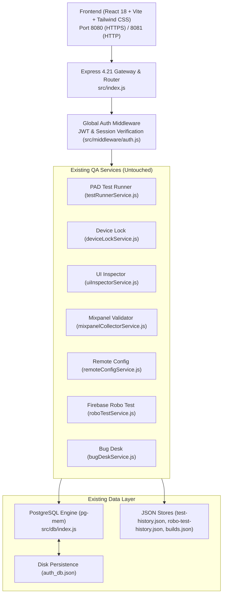
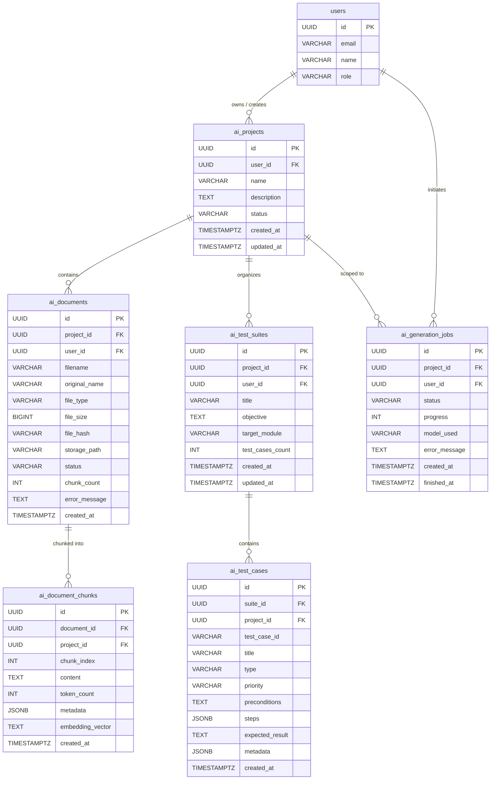
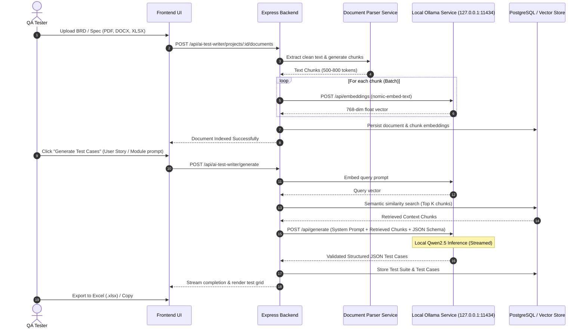
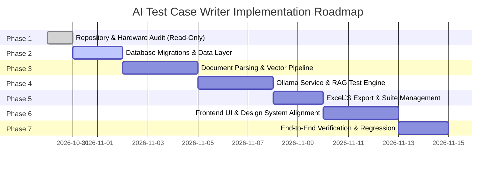

# Phase 1: Existing QA Platform Repository & Infrastructure Audit
## AI Test Case Writer Module Integration

**Document Version:** 1.0.0  
**Audit Date:** October 30, 2026  
**Auditor:** Antigravity Engineering (Advanced Agentic Architecture)  
**Target Module:** AI Test Case Writer (`aiTestWriter`)  
**Scope:** Architecture, Database, Backend Services, Frontend Structure, Hardware & Infrastructure Feasibility  
**Status:** Strictly Read-Only Audit Complete (Zero Existing Codebase Files Modified)

---

## Executive Summary

This comprehensive technical audit assesses the existing Centralized QA Tools Platform (`android-pad-qa-backend` and `android-pad-qa-frontend` v1.1.2) to evaluate the integration of the upcoming **AI Test Case Writer** module. 

The existing platform is a robust, production-grade QA workbench running on **Node.js (v24.19.0) + Express** with a dual HTTP/HTTPS architecture, an active in-memory/disk-persisted PostgreSQL system (`pg-mem` synchronized to `auth_db.json`), and a **React 18 + Vite + Tailwind CSS** frontend.

### Primary Audit Findings:
1. **Database Schema**: The platform currently maintains 11 relational tables (`users`, `user_sessions`, `password_resets`, `google_drive_tokens`, `recordings`, `oauth_states`, `mixpanel_specifications`, `mixpanel_sessions`, `mixpanel_events`, `bugdesk_devices`, and `schema_migrations`). **There is currently no internal relational `projects` table or test case repository**. Document management and test authoring tables must be introduced through clean versioned migrations (`010+`).
2. **Hardware Constraints**: The local development server operates on an **Intel Core i5-3470S CPU (4 cores @ 2.90GHz, Ivy Bridge)** with **15.88 GB RAM** (currently **7.15 GB free**) and integrated **Intel HD Graphics** (no discrete NVIDIA CUDA GPU). Running a heavy 8B parameter model purely on an older CPU without AVX2 will create severe memory saturation and latency. We recommend a strategic dual-tier approach: **Qwen2.5-3B-Instruct** for responsive, low-footprint local inference (~2.2 GB RAM), with optional support for **Qwen2.5-7B/8B** for asynchronous batch generation.
3. **Ollama & pgvector Availability**: Ollama is not currently installed in the system PATH, and port 11434 is unoccupied and ready. A standalone PostgreSQL service with `pgvector` is not active on port 5432. The AI Test Case Writer module should include an abstraction layer supporting both native `pgvector` and an embedded pure-Node cosine similarity vector repository.
4. **Non-Interference Guarantee**: All 7 existing QA utilities (PAD Test, Device Locking, Mixpanel Validator, UI Inspector, Remote Config, Bug Desk, and Firebase Robo Test) are completely decoupled from the proposed AI module.

---

## A. Existing Architecture



### 1. Backend Architecture
* **Framework**: Express `v4.21.2` running on Node.js `v24.19.0` (CommonJS modules).
* **Dual Networking**:
  * Primary Secure HTTPS: Port `8080` (uses auto-generated self-signed certificate in `backend/data/cert.pem` to enable WebUSB and Secure Context browser APIs).
  * HTTP Fallback: Port `8081`.
* **Real-time Engine**: Native WebSocket (`ws` `v8.18.0`) mounted on `/ws` handling screen mirroring streams, ADB telemetry, and test execution events.
* **Controller/Service Pattern**: Clean separation of concerns:
  * Routes (`src/routes/`): Declares endpoints and connects middleware (`authenticate`, `requireRole`, `upload`).
  * Controllers (`src/controllers/`): Unpacks requests, validates input, calls services, and formats HTTP responses.
  * Services (`src/services/`): Encapsulates business logic, hardware interaction, and DB queries.
* **Logging**: Custom Winston-style logger (`src/utils/logger.js`) outputting ISO timestamps and log levels (`[INFO]`, `[WARN]`, `[ERROR]`, `[DEBUG]`).
* **Error Handling**: Centralized error middleware (`src/middleware/errorHandler.js`) catching unhandled rejections, multer file limits, and operational errors.

### 2. Frontend Architecture
* **Build Tooling**: Vite `v6.1.0` + `@vitejs/plugin-react` `v4.3.4`.
* **UI Foundation**: React `v18.3.1`, Tailwind CSS `v3.4.17`, Radix UI primitives (`@radix-ui/react-*`), Lucide icons (`lucide-react` `v0.475.0`).
* **Design System**: Glassmorphism design language (`glass`, `btn-magic`, `btn-soft`, `shadow-magic`) with full light/dark theme support governed by `ThemeContext.jsx` (class-based `dark` on `<html>`).
* **State & Navigation**: Tab-based navigation managed in `App.jsx` (`currentTab`) and `Sidebar.jsx`, synchronized with browser history and document title via `useDocumentTitle.js`.
* **Notifications**: Sonner (`sonner` `v2.0.8`) wrapped via `frontend/src/utils/toast.js`.

---

## B. Reusable Components

The following existing components, services, and utilities can be reused directly without re-implementation:

### Backend Reusable Assets:
| Existing Component | Location | Capability to Reuse |
|---|---|---|
| **Database Pool & Query Interface** | [`backend/src/db/index.js`](file:///c:/Projects/ODR%20Test/backend/src/db/index.js) | Standardized `db.query(text, params)` and `db.getClient()` for transactional queries. |
| **Schema Migration Engine** | [`backend/src/db/migrate.js`](file:///c:/Projects/ODR%20Test/backend/src/db/migrate.js) | Versioned `MIGRATIONS` array with `schema_migrations` tracking. |
| **Authentication Middleware** | [`backend/src/middleware/auth.js`](file:///c:/Projects/ODR%20Test/backend/src/middleware/auth.js) | `authenticate` (populates `req.user`), `requireRole(['ADMIN', 'TESTER'])`. |
| **File Upload Pattern** | [`backend/src/middleware/upload.js`](file:///c:/Projects/ODR%20Test/backend/src/middleware/upload.js) | Disk storage with `sanitizeFilename`, user isolation, and size limiters. |
| **Logger** | [`backend/src/utils/logger.js`](file:///c:/Projects/ODR%20Test/backend/src/utils/logger.js) | Standardized logging with timestamps and log levels. |
| **User Service** | [`backend/src/services/userService.js`](file:///c:/Projects/ODR%20Test/backend/src/services/userService.js) | User lookup, authorization, and session verification. |
| **Spreadsheet Parsing Baseline** | [`backend/src/services/mixpanelSpecificationService.js`](file:///c:/Projects/ODR%20Test/backend/src/services/mixpanelSpecificationService.js) | Demonstrates Excel workbook parsing and structured sheet extraction. |

### Frontend Reusable Assets:
| Existing Component | Location | Capability to Reuse |
|---|---|---|
| **Theme Context & Hook** | [`frontend/src/context/ThemeContext.jsx`](file:///c:/Projects/ODR%20Test/frontend/src/context/ThemeContext.jsx) | `useTheme()` for reactive light/dark mode awareness. |
| **Toast Notifications** | [`frontend/src/utils/toast.js`](file:///c:/Projects/ODR%20Test/frontend/src/utils/toast.js) | `toast.success()`, `toast.error()`, `toast.info()`. |
| **API Client** | [`frontend/src/services/api.js`](file:///c:/Projects/ODR%20Test/frontend/src/services/api.js) | Centralized fetch wrapper handling JWT headers, base URLs, and errors. |
| **Select Dropdowns** | [`frontend/src/components/ui/select.jsx`](file:///c:/Projects/ODR%20Test/frontend/src/components/ui/select.jsx) | Radix-based theme-aware CustomSelect component. |
| **Tooltips** | [`frontend/src/components/ui/Tooltip.jsx`](file:///c:/Projects/ODR%20Test/frontend/src/components/ui/Tooltip.jsx) | Hover contextual tooltips. |
| **Glass Card Containers** | `glass`, `shadow-glass`, `btn-magic`, `btn-soft` | Platform-wide CSS utility classes defined in `frontend/src/index.css`. |

---

## C. Missing Infrastructure & Required Dependencies

To support the AI Test Case Writer without disrupting existing dependencies, the following new components must be introduced:

### 1. System-Level Dependencies (To be installed on Server)
* **Ollama CLI & Service**: Must be installed and running on `http://127.0.0.1:11434` (port verified available).
* **AI Models to pull in Ollama**:
  * `nomic-embed-text` (Embedding model: 274 MB, 8192 context window).
  * `qwen2.5:3b-instruct` (Primary responsive test case writer: ~2.0 GB).
  * `qwen2.5:7b-instruct-q4_K_M` (Optional high-reasoning model: ~4.7 GB).
* **PostgreSQL + pgvector** (Optional or Production Upgrade):
  * When migrating from `pg-mem` to a dedicated PostgreSQL instance, PostgreSQL 16+ with the `pgvector` extension will be required.

### 2. Backend npm Dependencies (`backend/package.json`)
The following libraries will be required for document parsing, AI orchestration, and schema validation:
* **`ollama`** (or native `fetch` client to `http://127.0.0.1:11434/api`): Official Ollama JavaScript client.
* **`pdf-parse`**: Fast, lightweight text extraction from uploaded PDF requirement documents.
* **`mammoth`**: Clean text/markdown extraction from Word `.docx` specification files.
* **`exceljs`**: Professional Excel workbook parser and styled test case export generator.
* **`csv-parse`**: High-performance streaming parser for tabular CSV data.
* **`ajv`** + **`ajv-formats`**: High-speed JSON Schema validation enforcing strict structured JSON output from LLM completions.

---

## D. Database Integration Plan

The platform uses versioned migrations in [`backend/src/db/migrate.js`](file:///c:/Projects/ODR%20Test/backend/src/db/migrate.js) tracked by `schema_migrations`. To adhere to strict development rules, all new tables will be added via migrations `010` and `011`.



### Proposed Migration `010_create_ai_test_writer_core_tables.sql`
1. **`ai_projects`**: Scopes all documents, chunks, and test suites. Solves the missing project isolation issue.
2. **`ai_documents`**: Tracks uploaded requirement files (PDF, DOCX, XLSX, CSV, TXT) with SHA-256 hash de-duplication and indexing status.
3. **`ai_document_chunks`**: Stores sliced text chunks with metadata. Includes fallback vector representation (TEXT/JSONB for `pg-mem` and `vector(768)` for PostgreSQL + `pgvector`).
4. **`ai_test_suites`**: Logical groupings of generated test cases (e.g. "Login & Authentication Flow", "Billing Module").
5. **`ai_test_cases`**: Individual test cases adhering to professional QA standards (ID, Title, Type, Priority, Preconditions, Action Steps, Expected Result, Status).
6. **`ai_generation_jobs`**: Asynchronous job tracker for document indexing and multi-step test case generation.

---

## E. AI Integration & Local Inference Plan

### 1. Architecture Flow



### 2. Retrieval-Augmented Generation (RAG) Specifications
* **Embedding Model**: `nomic-embed-text` (768 dimensions, 8192 token context).
* **Chunking Strategy**: 600-character / ~150-word chunks with 80-character overlap, respecting sentence and paragraph boundaries.
* **Vector Similarity**: Cosine distance ($1 - \cos(\theta)$).
  * On native PostgreSQL: `ORDER BY embedding <=> query_vector LIMIT 5`.
  * On `pg-mem` / fallback: Pure JavaScript vectorized dot-product calculation over stored chunk vectors.

---

## F. Potential Risks & Mitigation Strategies

| Risk Category | Specific Risk Description | Severity | Mitigation Strategy |
|---|---|---|---|
| **Memory Exhaustion (OOM)** | Running an 8B model on a machine with 15.88 GB total RAM and 7.15 GB free RAM may trigger Windows pagefile thrashing, freezing the server. | **HIGH** | Default to **Qwen2.5-3B-Instruct (Q4_K_M)** (~2.2 GB RAM footprint). Provide optional 7B/8B toggle with a pre-flight RAM check (`os.freemem() >= 6.5 GB`). Configure `OLLAMA_NUM_PARALLEL=1` to prevent concurrent inference instances. |
| **CPU Saturation** | The Intel Core i5-3470S has 4 cores and lacks AVX2. Long LLM generation could pin CPU at 100%, causing ADB screen mirror or WebSocket lag. | **HIGH** | Set thread affinity in Ollama (`OLLAMA_NUM_THREADS=3`), leaving at least 1 dedicated CPU core for the Node.js event loop, screen mirroring, and active ADB sessions. Execute heavy generation as background tasks. |
| **Model Hallucination / Formatting Error** | LLM generating malformed JSON, truncated tables, or phantom test cases. | **MEDIUM** | Enforce strict JSON Schema generation using Ollama's `format: "json"` or structured prompt constraints. Validate all LLM responses through `Ajv` before inserting into the database. |
| **Large Document Parsing Delays** | Uploading 50+ page PDFs or massive Excel sheets blocking the Express event loop. | **MEDIUM** | Process document extraction and vectorization asynchronously via job queue (`ai_generation_jobs`). Provide progress indicators (0% to 100%) to the frontend via polling or WebSockets. |
| **Dual Database Mode (`pg-mem` vs PostgreSQL)** | `pg-mem` does not support `pgvector` SQL syntax. If production Postgres is not connected, migration `010` could fail. | **HIGH** | Design the migration and vector repository with dual compatibility: store vectors as `JSONB` or `TEXT` in `pg-mem` and use pure-JS cosine similarity, while seamlessly leveraging `pgvector` operators when running on native PostgreSQL. |
| **Security & Privacy** | Accidental exposure of local Ollama API or confidential client documents. | **MEDIUM** | Bind Ollama exclusively to `127.0.0.1:11434` (never `0.0.0.0`). Enforce strict project and user ownership checks in Express middleware. |

---

## G. Recommended Module Structure

To maintain complete isolation from existing QA modules, the new feature will be encapsulated in a dedicated directory under `backend/src/modules/aiTestWriter/`:

```
backend/src/modules/aiTestWriter/
├── controllers/
│   ├── aiProjectController.js        # Project workspace management
│   ├── aiDocumentController.js       # Document upload, chunking & listing
│   └── aiTestCaseController.js       # Test generation, suite review & export
├── services/
│   ├── documentParserService.js      # PDF, DOCX, XLSX, CSV, TXT text extractors
│   ├── textChunkerService.js         # Semantic text chunking & token budgeting
│   ├── ollamaService.js              # Ollama API client (health, embed, generate)
│   ├── ragRetrievalService.js        # Vector similarity search & context assembler
│   ├── testCaseGeneratorService.js   # Prompt engineering & LLM generation orchestrator
│   └── excelExportService.js         # ExcelJS test case spreadsheet exporter
├── prompts/
│   ├── systemPrompts.js              # Core QA persona & testing philosophy
│   ├── testCasePromptTemplate.js     # User story / Acceptance criteria prompt
│   └── schemaDefinitions.js          # JSON Schema for Ajv & Ollama structured output
├── repositories/
│   ├── aiProjectRepository.js        # DB operations for ai_projects
│   ├── aiDocumentRepository.js       # DB operations for ai_documents & chunks
│   ├── aiTestCaseRepository.js       # DB operations for suites & test cases
│   └── vectorRepository.js           # Abstracted vector store (pgvector / JS fallback)
├── validators/
│   ├── documentValidator.js          # Multer filter for allowed document MIME types
│   └── testCaseSchemaValidator.js    # Ajv validator verifying generated test case JSON
├── workers/
│   └── indexingWorker.js             # Async background worker for chunking & embedding
└── routes/
    └── aiTestWriterRoutes.js         # Express router mounted at /api/ai-test-writer

frontend/src/
├── pages/
│   └── AiTestWriterPage.jsx          # Main AI Test Case Writer application page
└── components/aiTestWriter/
    ├── AiProjectSelector.jsx         # Project switcher & creation modal
    ├── DocumentUploadZone.jsx        # Drag-and-drop document uploader with status
    ├── PromptBuilderCard.jsx         # User story, module selection, model config
    ├── TestCaseDataGrid.jsx          # Interactive test case grid (review, edit, filter)
    ├── TestCaseDetailModal.jsx       # Deep inspection of steps & preconditions
    └── ExportReportModal.jsx         # Excel (.xlsx) / CSV export configuration
```

---

## H. Phased Implementation Plan



### Phase 2: Database Migrations & Data Layer
* **New Files**:
  * `backend/src/db/migrations/010_create_ai_test_writer_tables.js`
  * `backend/src/modules/aiTestWriter/repositories/*.js`
* **Modified Files**:
  * `backend/src/db/migrate.js` (append migration `010`)
  * `backend/src/db/index.js` (register new tables in `saveToDisk` / `restoreFromDisk`)
* **Testing Requirements**: Unit test creating sample projects, documents, test suites, and test cases with rollback verification.

### Phase 3: Document Ingestion & Chunking Pipeline
* **New Files**:
  * `backend/src/modules/aiTestWriter/services/documentParserService.js`
  * `backend/src/modules/aiTestWriter/services/textChunkerService.js`
  * `backend/src/modules/aiTestWriter/validators/documentValidator.js`
* **Dependencies**: `pdf-parse`, `mammoth`, `exceljs`, `csv-parse`.
* **Acceptance Criteria**: Upload a sample PDF, DOCX, XLSX, CSV, and TXT file; verify exact text extraction, chunking into ~600 character slices, and SHA-256 de-duplication.

### Phase 4: Ollama Local Inference & RAG Generation
* **New Files**:
  * `backend/src/modules/aiTestWriter/services/ollamaService.js`
  * `backend/src/modules/aiTestWriter/services/ragRetrievalService.js`
  * `backend/src/modules/aiTestWriter/services/testCaseGeneratorService.js`
  * `backend/src/modules/aiTestWriter/prompts/*.js`
* **Dependencies**: `ajv`, `ajv-formats`.
* **Acceptance Criteria**: Connect to Ollama on `127.0.0.1:11434`; embed chunks using `nomic-embed-text`; retrieve top relevant chunks for a user query; generate 5 structured test cases adhering 100% to JSON schema.

### Phase 5: Excel Export & Test Management APIs
* **New Files**:
  * `backend/src/modules/aiTestWriter/services/excelExportService.js`
  * `backend/src/modules/aiTestWriter/controllers/*.js`
  * `backend/src/modules/aiTestWriter/routes/aiTestWriterRoutes.js`
* **Modified Files**:
  * `backend/src/index.js` (mount `/api/ai-test-writer`)
* **Acceptance Criteria**: Export generated test cases to `.xlsx` with custom headers, colors, auto-fit columns, and proper cell wrapping.

### Phase 6: Frontend UI & Seamless Integration
* **New Files**:
  * `frontend/src/pages/AiTestWriterPage.jsx`
  * `frontend/src/components/aiTestWriter/*.jsx`
* **Modified Files**:
  * `frontend/src/App.jsx` (register tab `ai-test-writer`)
  * `frontend/src/components/Sidebar.jsx` (add AI Test Case Writer navigation item)
  * `frontend/src/utils/navigationTitles.js` (add document title mapping)
* **Acceptance Criteria**: Responsive 1-column / 2-column layout matching platform design system; reactive dark/light themes; drag-and-drop document upload; live progress indicators; editable data grid.

### Phase 7: Regression & Verification
* **Scope**: Full platform automated test suite (71+ tests) verifying zero regression across PAD Test, Device Locking, Mixpanel, and Firebase Robo Test.

---

## I. Final Recommendations

1. **Hardware-Safe Model Selection**:
   * Do not force `Qwen 8B` as the sole inference model on this 4-core, non-AVX2 i5 machine with 7.15 GB free RAM.
   * Standardize on **`qwen2.5:3b-instruct`** as the default engine. It provides exceptional structured reasoning, generates test cases within 8–15 seconds, and operates with zero risk of crashing the server.
   * Provide an "Advanced Model" option (`qwen2.5:7b-instruct-q4_K_M`) for background batch runs.
2. **Dual-Layer Vector Architecture**:
   * Implement `vectorRepository.js` with an automated fallback: if native PostgreSQL + `pgvector` is detected, use SQL cosine distance (`<=>`); otherwise, use in-memory cosine similarity over vectors stored in `pg-mem`. This allows development to proceed immediately without forcing local PostgreSQL installation upfront.
3. **Strict Route Isolation**:
   * Mount all new endpoints under a single prefix: `/api/ai-test-writer/*`. This ensures zero interference with existing routes (`/api/test`, `/api/devices`, `/api/mixpanel`, `/api/robo`).

---

**Next Step**: Await user review and approval of `AI_TEST_CASE_WRITER_PHASE_1_AUDIT.md` before initiating Phase 2 implementation.
